

  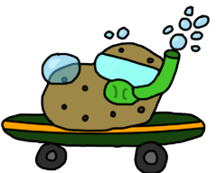

# Patata subacuática montada en Monopatín — Fairy Lab Run

**Juegos en Red · Grado en Diseño y Desarrollo de Videojuegos · URJC · Curso 2026/27** 
**Grupo E**

## Descripción de la temática

"Fairy Lab Run" es un juego de carrera/plataformas en 2D para varios jugadores en red en el que puedes empujar a tus adversarios. Ambientado en un laboratorio, los jugadores deben llegar a la meta los primeros para ganar la partida.

## Equipo de desarrollo

| Nombre y apellidos | Correo URJC | GitHub |
| :--- | :--- | :--- |
| Andrés López Duque | a.lopezd.2024@alumnos.urjc.es | `@Andres12w` |
| Adrián Manzanera Martínez | a.manzanera.2024@alumnos.urjc.es | `@Spelunky233` |
| Guillermo Nombela Molina | g.nombela.2024@alumnos.urjc.es | `@UTorio` |
| Óscar Castañeda Serrano | o.castaneda.2024@alumnos.urjc.es | `@13Golosina` |

**Repositorio:** `https://github.com/UTorio/GrupoP`

**Licencia:** [Apache 2.0](LICENSE)

---

# Game Design Document (GDD)

## Índice

1. [Introducción](#1-introducción)
2. [Especificaciones básicas](#2-especificaciones-básicas)
3. [Jugabilidad](#3-jugabilidad)
4. [Narrativa](#4-narrativa)
5. [Imagen y diseño visual](#5-imagen-y-diseño-visual)
6. [Sonido](#6-sonido)
7. [Interfaz y diagrama de flujo](#7-interfaz-y-diagrama-de-flujo)
8. [Comunicación y marketing](#8-comunicación-y-marketing)
9. [Referencias](#9-referencias)

## 1. Introducción

### 1.1. Concepto del juego

"Fairy Lab Run" es un juego de carreras/plataformas para varios jugadores en el que compiten para llegar a la meta. La idea principal es los jugadores pueden entorpecerse y hay obstáculos en el mapa.

### 1.2. Propuesta de valor

Los personajes tienen una habilidad que empuja a los demás.

- Característica diferencial 1: Empuje de los jugadores.
- Característica diferencial 2: Objetos que benefician al que los recoge.
- Característica diferencial 3: Trampas que entorpecen a los jugadores.

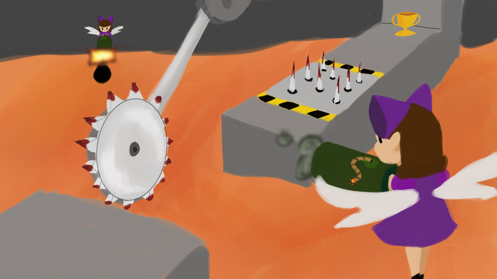

*Figura 1. Imagen promocional del juego.*

---

## 2. Especificaciones básicas

| Aspecto | Descripción |
| :--- | :--- |
| **Título** | Fairy Lab Run |
| **Género** | Carreras/Plataformas |
| **Número de jugadores** | De 2 a 4 jugadores (en red, tiempo real) |
| **Público objetivo** | Jugadores casuales que quieren pasar un rato divertido entre amigos |
| **Clasificación PEGI** | PEGI 12. Habrá violencia moderada (explosiones, colisiones, etc.), presencia leve de sangre. |
| **Plataforma** | Navegador web (PC), desarrollado con Phaser 3 |
| **Duración de una partida** | Alrededor de 5 minutos |
| **Representación** | 2D |
| **Licencia** | Apache 2.0 |

---

## 3. Jugabilidad

### 3.1. Objetivo del juego

La partida termina cuando un jugador llega a la meta. Gana el jugador que llega el primero.
Para alzarse con la victoria, los jugadores podrán empujarse unos a otros para ralentizarse entre ellos.

### 3.2. Controles

| Acción | Jugador 1 | Jugador 2 |
| :--- | :---: | :---: |
| Moverse a la izquierda | `A` | `←` |
| Moverse a la derecha | `D` | `→` |
| Saltar | `Barra espaciadora` | `↑` |
| Acción especial De empuje | `Botón izquierdo del ratón` | `Intro` |
| Pausa | `Esc` | `Esc` |

### 3.3. Mecánicas

#### 3.3.1. Mecánicas principales

- **Empuje:** El jugador puede empujar a los demás jugadores en un radio circular desde su posición.
- **Colisión:** Los jugadores se chocan entre ellos.
- **Objetos:** Hay objetos que potencian al jugador o perjudican al resto.

#### 3.3.2. Objetos y power-ups

| Objeto | Efecto | Duración | Aparición |
| :--- | :--- | :---: | :--- |
| Bebida energética | Al usarla te hace ir más rápido por un momento. | 5 s | Zonas aleatorias en el mapa |
| Escudo | Al usarlo resistes el próximo golpe recibido (No cuenta caer en un agujero) | Instantáneo |  Zonas aleatorias en el mapa  |
| Pesas | Al usarlas durante un tiempo no se te puede empujar, y tus empujes son más fuertes. | 10s |  Zonas aleatorias en el mapa  |
| Ruleta | Al usarla cambias de posición con un jugador al azar (tanto de delante como de detrás). | Instantáneo |  Zonas aleatorias en el mapa  |
| Cometa | Al usarla te vuelves inmortal, no se te puede empujar y eres más rápido por un breve momento (Caer en un agujero te mata) | 10s |  Zonas aleatorias en el mapa  |
| Melodía | Al usarla ralentizas al resto de rivales, sin efecto si están usando la bebida energética o el cometa. | 5s |  Zonas aleatorias en el mapa  |
| Hielo | Al usarlo congelas al próximo rival que empujes. El rival empujado no se podrá mover por un momento. | Instantáneo |  Zonas aleatorias en el mapa  |
| Botas aladas | Al usarlas por un tiempo puedes realizar dobles saltos. | 5s |  Zonas aleatorias en el mapa  |

#### 3.3.3. Sistema de puntuación

Cada partida ganada suma 1 al contador de victorias del jugador. Los puntos solo sirven para contar las victorias totales de cada jugador durante la sesión de juego.

### 3.4. Físicas y dificultad

- **Gravedad y salto:** Saltar genera un impulso vertical de potencia constante (no afecta dejar el botón pulsado más o menos tiempo).
- **Colisiones:** Hay colisión con el suelo y con los enemigos y proyectiles. No habrá colisiones entre jugadores.
- **Rebotes / fricción / empujes:** Al pulsar el botón de empuje, se genera un área de efecto y si algún rival se encuentra dentro de esta recibe un empuje en la dirección de la colisión.
- **Plataformas móviles o superficies especiales (hielo, rebote...):** Hay distintos tipos de suelo y, por lo tanto, distintas fricciones con estos. Hay algunas plataformas móviles que se muevan de forma vertical u horizontal.
- **Progresión de la dificultad:** La dificultad depende principalmente del nivel de habilidad de tus rivales. También hay una selección de mapas cada uno con un nivel de dificultad distinto.

### 3.5. Escenario

Hay 3 niveles distintos:

1. **Nivel 1:** First jumps.
2. **Nivel 2:** Yuliya's Wrath.
3. **Nivel 3:** When hell freezes.

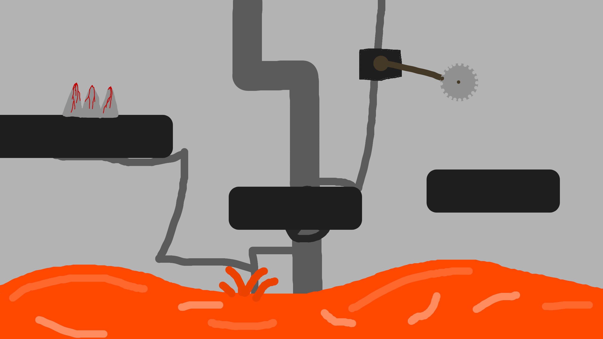

*Figura 2. Mapa del escenario con zonas de aparición, plataformas y obstáculos.*

---

## 4. Narrativa

### 4.1. Historia

Las hadas están en guerra y en un laboratorio secreto están tratando de desarrollar una criatura capaz de sortear obstáculos e invadir territorio enemigo. Para decidir cuál es la mejor de las criaturas las pondrán a competir en letales carreras hasta tener solo una selección de las mejores, pero debido a la capacidad de atención y de memoria bajísima o nula de las hadas, se les olvida constantemente que están en guerra, por lo que lo convierten también en un programa de televisión titulado Fairy Lab Run.

### 4.2. Personajes

#### L.O.B.I.T.O

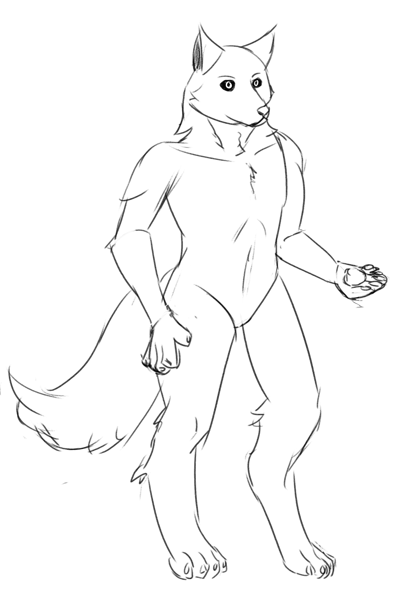

- **Edad / origen:** Recién nacido.
- **Personalidad:** Ninguna.
- **Motivación:** Sobrevivir.
- **Habilidad especial:** Empujar a sus congéneres.
- **Trasfondo:** Artificialmente creado hace unos minutos, puesto a correr en la fairy lab run.

#### Hada Yuliya 

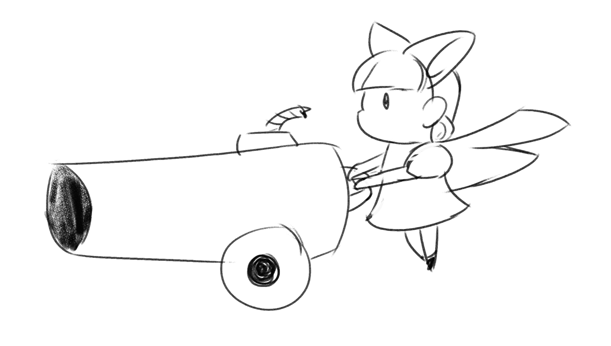

Es un hada que maneja un cañón y dispara a los corredores para entorpecer su camino.

---

## 5. Imagen y diseño visual

### 5.1. Logotipo

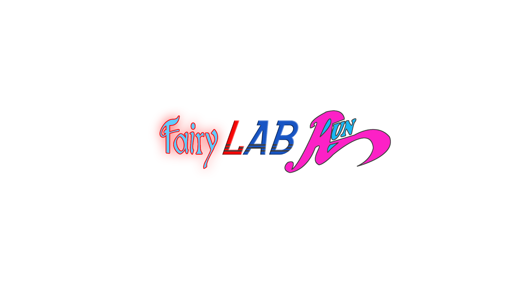

### 5.2. Estilo visual

El juego utiliza un estilo **Dibujado en digital** porque tenemos en el grupo a alguien que se le da bien dibujar, y también es mas fácil de animar que el pixel art y nos da mas libertad creativa a la hora de poder añadir o animar cosas.

### 5.3. Uso de colores

*Figura 4. Paleta de colores del juego.*

- **Fondos:** cada nivel tendrá una tonalidad mas roja que el anterior.
 
- **Jugadores :** habrá unos sliders de seleccion de color del pelaje para personalizacion y diferencicación.
- **Objetos :** Cada objeto tendrá una paleta de color distinta, siempre incluyendo algun color que contraste con los de los fondos.
- **Yuliya :** Cada hada Yuliya usará estos colores, para que sea reconocible rápidamente.

### 5.4. Aspectos técnicos: cámara y representación

- **Representación:** 2D, vista lateral.
- **Cámara:** Cámara fijada en los personajes jugables. Cada jugador ve la cámara centrada en su personaje.
- **Resolución base:** 1920 × 1080 píxeles.

### 5.5. Inspiración artística y cultural

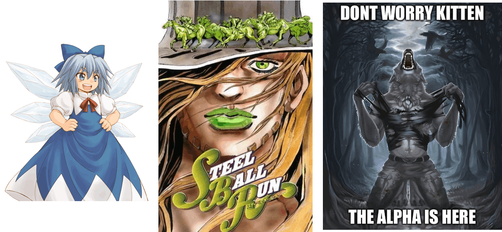

*Figura 5. Moodboard con las referencias visuales.*

- (videojuego, año): Touhou 1997 [1].
- (película / cómic / movimiento artístico): Steel Ball Run 2004 [2].
- (referencia cultural): Comunidad de entusiastas de personajes antropomórficos. [3].

### 5.6. Bocetos de personajes y pantallas

Los bocetos de los personajes se encuentran en el apartado [4.2](#42-personajes) y los de las pantallas en el apartado [7.1](#71-pantallas).

---

## 6. Sonido

### 6.1. Banda sonora

| Pista | Escena | Estilo / ambiente | Fuente / licencia |
| :--- | :--- | :--- | :--- |
| Elevator panik | Menú principal | Electrónica, con impacto | Propia |
| Run into the hills | Partida | Eurobeat, rápido y enérgico | Propia |
| Survivors chyme | Victoria / derrota | Alegre, calmada / decepcionante, lenta | Propia |

### 6.2. Efectos de sonido

| Efecto | Momento en que se reproduce |
| :--- | :--- |
| Salto | Al pulsar la tecla de salto |
| Golpe / impacto | Al disparar la onda de choque / al conectar con un jugador rival |
| Recoger objeto | Al recoger un objeto |
| Botones de la interfaz | Al pasar el ratón y al hacer clic |
| Cuenta atrás | Antes de empezar una carrera |
| Chicken screaming on a tree | Al caer en un pozo de lava |

---

## 7. Interfaz y diagrama de flujo

### 7.1. Pantallas

**Menú principal**

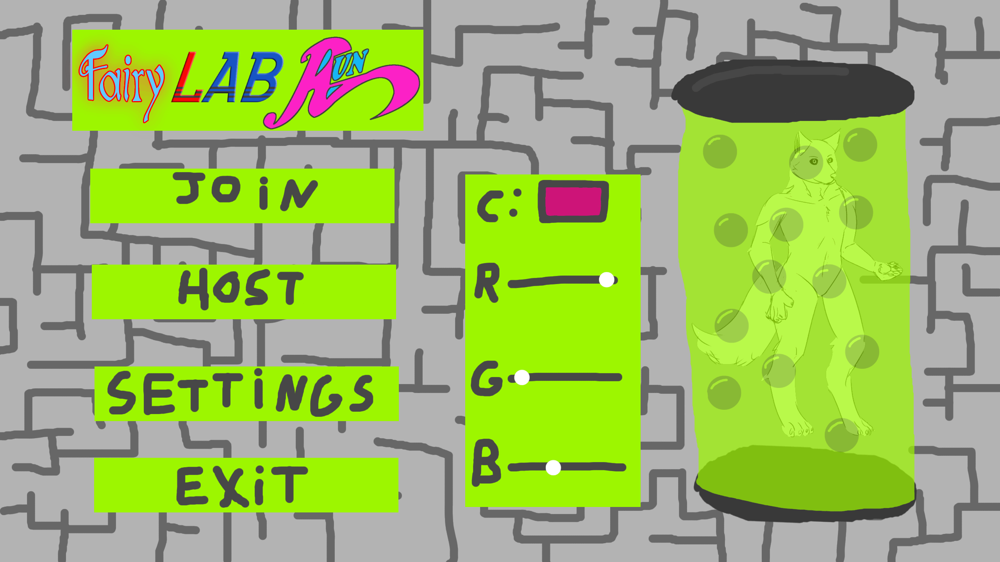

*Figura 6. Menú principal.*

**Pantalla de juego (HUD)**

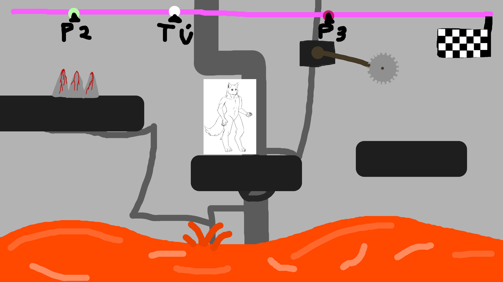

*Figura 7. Pantalla de juego: Pantalla de una escena de una carrera.*

**Ajustes y fin de partida**

  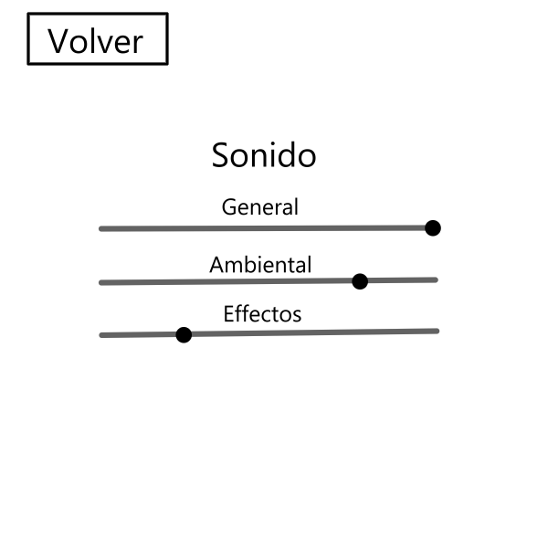
  

*Figura 8. Pantalla de ajustes (izquierda) y fin de partida (derecha).*

### 7.2. Diagrama de flujo

**Opción 1 — Mermaid** (se dibuja automáticamente en GitHub):

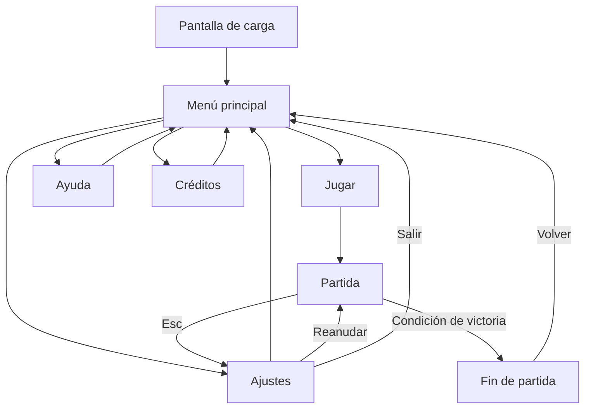

*Figura 9. Diagrama de flujo entre pantallas.*

---

## 8. Comunicación y marketing

- **Público y mensaje clave:** Diviértete con tus amigos retándolos a frenéticas carreras.
- **Canales:** Redes sociales (YouTube, X), itch.io.
- **Calendario:** *teaser* en noviembre de 2026, *devlog* semanal, lanzamiento en Enero de 2027.
- **Material:** tráiler saldrá con el teaser. 
- **Eslogan:** «¡Empuja a tus amigos!».

---

## 9. Referencias

[1] ZUN / Team Shangai Alice. Touhou (1996). 

[2] DoubleDutch Games / tinyBuild. Speedrunners (2016).

[3] Schell, J. (2019). *The Art of Game Design: A Book of Lenses* (3.ª ed.). CRC Press.

[4] Phaser Studio. (s. f.). *Phaser 3 Documentation*. https://docs.phaser.io

[5] Recursos de terceros utilizados (sprites, música, fuentes): Ninguno.
