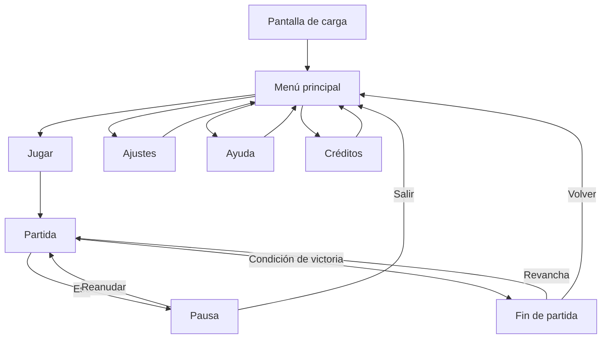

  

# Patata subacuática montada en Monopatín — Nombre del juego

**Juegos en Red · Grado en Diseño y Desarrollo de Videojuegos · URJC · Curso 2026/27** 
**Grupo E**

## Descripción de la temática

AAA es un juego de carrera/plataformas en 2D para varios jugadores en red en el que puedes empujar a tus adversarios. Ambientado en un laboratorio, los jugadores deben llegar a la meta los primeros para ganar la partida.

## Equipo de desarrollo

| Nombre y apellidos | Correo URJC | GitHub |
| :--- | :--- | :--- |
| Andrés López Duque | a.lopezd.2024@alumnos.urjc.es | `@Andres12w` |
| Adrián Manzanera Martínez | a.manzanera.2024@alumnos.urjc.es | `@Spelunky233` |
| Guillermo Nombela Molina | g.nombela.2024@alumnos.urjc.es | `@UTorio` |
| Óscar Castañeda Serrano | o.castaneda.2024@alumnos.urjc.es | `@13Golosina` |

**Repositorio:** `https://github.com/UTorio/GrupoP`

**Licencia:** [Apache 2.0](LICENSE)

---

# Game Design Document (GDD)

## Índice

1. [Introducción](#1-introducción)
2. [Especificaciones básicas](#2-especificaciones-básicas)
3. [Jugabilidad](#3-jugabilidad)
4. [Narrativa](#4-narrativa)
5. [Imagen y diseño visual](#5-imagen-y-diseño-visual)
6. [Sonido](#6-sonido)
7. [Interfaz y diagrama de flujo](#7-interfaz-y-diagrama-de-flujo)
8. [Comunicación y marketing](#8-comunicación-y-marketing)
9. [Referencias](#9-referencias)

## 1. Introducción

### 1.1. Concepto del juego

AAA es un juego de carreras/plataformas para varios jugadores en el que compiten para llegar a la meta. La idea principal es los jugadores pueden entorpecerse y hay obstáculos en el mapa.

### 1.2. Propuesta de valor

Los personajes tienen una habilidad que empuja a los demás.

- Característica diferencial 1: Empuje de los jugadores.
- Característica diferencial 2: Objetos que benefician al que los recoge.
- Característica diferencial 3: Trampas que entorpecen al los jugadores.

*Figura 1. Imagen promocional del juego.*

---

## 2. Especificaciones básicas

> *Rúbrica — Documento / Especificaciones básicas:* género, público objetivo/edad y plataforma.

| Aspecto | Descripción |
| :--- | :--- |
| **Título** | AAA |
| **Género** | Carreras/Plataformas |
| **Número de jugadores** | De 2 a 4 jugadores (en red, tiempo real) |
| **Público objetivo** | Jugadores casuales que quieren pasar un rato divertido entre amigos |
| **Clasificación PEGI** | PEGI 7. Habrá violencia leve (explosiones, colisiones, etc.), pero en un contexto caricaturesco en el que los personajes no sufren daño visible. |
| **Plataforma** | Navegador web (PC), desarrollado con Phaser 3 |
| **Duración de una partida** | Alrededor de 5 minutos |
| **Representación** | 2D |
| **Licencia** | Apache 2.0 |

---

## 3. Jugabilidad

### 3.1. Objetivo del juego

> *Rúbrica — Jugabilidad / Objetivo del juego:* debe estar claramente definido.

La partida termina cuando un jugador llega a la meta. Gana el jugador que llega el primero.
Para alzarse con la victoria, los jugadores podrán empujarse unos a otros para ralentizarse entre ellos.

### 3.2. Controles

> *Rúbrica — Jugabilidad / Controles.* Indicad teclado y ratón.

| Acción | Jugador 1 | Jugador 2 |
| :--- | :---: | :---: |
| Moverse a la izquierda | `A` | `←` |
| Moverse a la derecha | `D` | `→` |
| Saltar | `Barra espaciadora` | `↑` |
| Acción especial De empuje | `Botón izquierdo del ratón` | `Intro` |
| Pausa | `Esc` | `Esc` |

### 3.3. Mecánicas

> *Rúbrica — Jugabilidad / Mecánicas.*

#### 3.3.1. Mecánicas principales

- **Empuje:** El jugador puede empujar a los demás jugadores en un radio circular desde su posición.
- **Colisión:** Los jugadores se chocan entre ellos.
- **Objetos:** Hay objetos que potencian al jugador o perjudican al resto.

#### 3.3.2. Objetos y power-ups

| Objeto | Efecto | Duración | Aparición |
| :--- | :--- | :---: | :--- |
| Bebida energética | Al usarla te hace ir más rápido por un momento. | 5 s | (por definir) |
| Escudo | Al usarlo resistes el próximo golpe recibido (No cuenta caer en un agujero) | Instantáneo | (por definir) |
| Pesas | Al usarlas durante un tiempo no se te puede empujar, y tus empujes son más fuertes. | 10s | (por definir) |
| Ruleta | Al usarla cambias de posición con un jugador al azar (tanto de delante como de detrás). | Instantáneo | (por definir) |
| Cometa | Al usarla te vuelves inmortal, no se te puede empujar y eres más rápido por un breve momento (Caer en un agujero te mata) | 10s | (por definir) |
| Melodía | Al usarla ralentizas al resto de rivales, sin efecto si están usando la bebida energética o el cometa. | 5s | (por definir) |
| Hielo | Al usarlo congelas al próximo rival que empujes. El rival empujado no se podrá mover por un momento. | Instantáneo | (por definir) |
| Botas aladas | Al usarlas por un tiempo puedes realizar dobles saltos. | 5s | (por definir) |

#### 3.3.3. Sistema de puntuación

Cada partida ganada suma 1 al contador de victorias del jugador. Los puntos solo sirven para contar las victorias totales de cada jugador durante la sesión de juego.

### 3.4. Físicas y dificultad

> *Rúbrica — Jugabilidad / Físicas:* físicas variadas con elementos de dificultad.

- **Gravedad y salto:** 
- **Colisiones:** AAA AAA AAA (con plataformas, entre jugadores, con proyectiles...).
- **Rebotes / fricción / empujes:** AAA AAA AAA.
- **Plataformas móviles o superficies especiales (hielo, rebote...):** AAA AAA AAA.
- **Progresión de la dificultad:** a medida que avanza la partida AAA AAA AAA.

### 3.5. Escenario

> *Rúbrica — Jugabilidad / Calidad del escenario.*

El escenario representa AAA AAA AAA. Se compone de AAA zonas:

1. **Zona AAA:** AAA AAA AAA.
2. **Zona BBB:** BBB BBB BBB.
3. **Zona CCC:** CCC CCC CCC.

*Figura 2. Mapa del escenario con zonas de aparición, plataformas y obstáculos.*

---

## 4. Narrativa

> *Rúbrica — Narrativa:* riqueza de la historia principal y de los personajes.

### 4.1. Historia

AAA AAA AAA AAA AAA AAA AAA AAA AAA AAA AAA AAA AAA AAA AAA AAA AAA AAA AAA AAA AAA AAA AAA AAA AAA AAA AAA AAA.

AAA AAA AAA AAA AAA AAA AAA AAA AAA AAA AAA AAA AAA AAA AAA AAA AAA AAA AAA AAA.

### 4.2. Personajes

#### AAA (Jugador 1)

- **Edad / origen:** AAA.
- **Personalidad:** AAA AAA AAA.
- **Motivación:** AAA AAA AAA.
- **Habilidad especial:** AAA AAA AAA.
- **Trasfondo:** AAA AAA AAA AAA AAA AAA AAA AAA AAA.

#### BBB (Jugador 2)

- **Edad / origen:** BBB.
- **Personalidad:** BBB BBB BBB.
- **Motivación:** BBB BBB BBB.
- **Habilidad especial:** BBB BBB BBB.
- **Trasfondo:** BBB BBB BBB BBB BBB BBB BBB BBB BBB.

#### CCC (enemigo / personaje no jugable)

CCC CCC CCC CCC CCC CCC CCC CCC.

---

## 5. Imagen y diseño visual

### 5.1. Logotipo

> *Rúbrica — Imagen / Logotipo.*

*Figura 3. Logotipo del juego. Tipografía: AAA. Concepto: AAA AAA AAA.*

### 5.2. Estilo visual

> *Rúbrica — Imagen / Estilo visual:* pixel art, cartoon, vectorial, etc.

El juego utiliza un estilo **AAA** (p. ej. *pixel art* de 32×32 píxeles) porque AAA AAA AAA.

### 5.3. Uso de colores

> *Rúbrica — Imagen / Descripción visual:* uso de colores.

*Figura 4. Paleta de colores del juego.*

- **Fondo (`#1B1F3B`):** AAA AAA AAA.
- **Jugador 1 (`#E94560`) / Jugador 2 (`#0F9BD7`):** colores complementarios para distinguir fácilmente a cada jugador.
- **Objetos (`#F5C518`):** AAA AAA AAA.

### 5.4. Aspectos técnicos: cámara y representación

> *Rúbrica — Imagen / Aspectos técnicos:* uso de cámara y 2D/3D.

- **Representación:** 2D, vista AAA (lateral / cenital / isométrica).
- **Cámara:** AAA (fija mostrando todo el escenario / sigue a ambos jugadores con *zoom* dinámico / pantalla dividida...).
- **Resolución base:** AAA × AAA píxeles.

### 5.5. Inspiración artística y cultural

> *Rúbrica — Imagen / Inspiración:* referentes artísticos y culturales y vínculo con otros trabajos.

*Figura 5. Moodboard con las referencias visuales.*

- **AAA** (videojuego, año): tomamos AAA AAA AAA [1].
- **BBB** (película / cómic / movimiento artístico): BBB BBB BBB [2].
- **CCC** (referencia cultural): CCC CCC CCC.

### 5.6. Bocetos de personajes y pantallas

> *Rúbrica — Imagen / Bocetos:* interfaz de menú, pantallas y personajes.

Los bocetos de los personajes se encuentran en el apartado [4.2](#42-personajes) y los de las pantallas en el apartado [7.1](#71-pantallas).

---

## 6. Sonido

> *Rúbrica — Sonido:* música y efectos.

### 6.1. Banda sonora

| Pista | Escena | Estilo / ambiente | Fuente / licencia |
| :--- | :--- | :--- | :--- |
| AAA | Menú principal | AAA (p. ej. *chiptune* relajado) | AAA (propia / CC-BY...) |
| BBB | Partida | BBB (p. ej. ritmo rápido, 140 BPM) | BBB |
| CCC | Victoria / derrota | CCC | CCC |

### 6.2. Efectos de sonido

| Efecto | Momento en que se reproduce |
| :--- | :--- |
| Salto | Al pulsar la tecla de salto |
| Golpe / impacto | AAA |
| Recoger objeto | AAA |
| Botones de la interfaz | Al pasar el ratón y al hacer clic |
| Cuenta atrás | AAA |

---

## 7. Interfaz y diagrama de flujo

### 7.1. Pantallas

**Menú principal**

*Figura 6. Menú principal: AAA AAA AAA.*

**Pantalla de juego (HUD)**

*Figura 7. Pantalla de juego: AAA AAA AAA.*

**Ajustes y fin de partida**

  
  

*Figura 8. Pantalla de ajustes (izquierda) y fin de partida (derecha).*

### 7.2. Diagrama de flujo

> *Rúbrica — Documento / Diagrama de flujo.* Podéis usar Mermaid (GitHub lo renderiza directamente) o una imagen exportada.

**Opción 1 — Mermaid** (se dibuja automáticamente en GitHub):

**Opción 2 — Imagen** exportada desde draw.io, Excalidraw, Figma...:

*Figura 9. Diagrama de flujo entre pantallas.*

---

## 8. Comunicación y marketing

> *Rúbrica — Comunicación / Marketing.*

- **Público y mensaje clave:** AAA AAA AAA.
- **Canales:** redes sociales (AAA, BBB), itch.io, Newgrounds, Game Jolt...
- **Calendario:** *teaser* en AAA, *devlog* semanal en AAA, lanzamiento en AAA.
- **Material:** tráiler, capturas, GIF de jugabilidad, *press kit*.
- **Eslogan:** «AAA AAA AAA».

---

## 9. Referencias

> *Rúbrica — Documento / Referencias.* Usad un formato consistente (p. ej. APA) y citadlas en el texto con [1], [2]...

[1] AAA, A. (Año). *Título de la obra*. Editorial / Estudio. URL

[2] BBB, B. (Año). *Título del artículo*. Revista, volumen(número), páginas. https://doi.org/AAA

[3] Schell, J. (2019). *The Art of Game Design: A Book of Lenses* (3.ª ed.). CRC Press.

[4] Phaser Studio. (s. f.). *Phaser 3 Documentation*. https://docs.phaser.io

[5] Recursos de terceros utilizados (sprites, música, fuentes): AAA — autor — licencia — URL.
